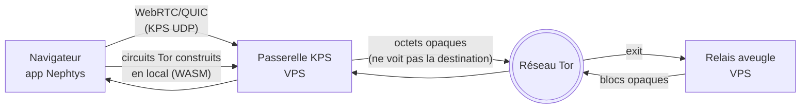

# Nephtys

**Nephtys** est une plateforme de communication chiffrée développée par **Jematechnology**. Elle propose une messagerie de bout en bout, des appels audio/vidéo WebRTC, des groupes, des statuts éphémères, et un **mode privé sans compte** avec **routage Tor « un clic » depuis le navigateur** (client Tor en WebAssembly — aucune extension, aucune installation).

> Application 100 % navigateur (PWA). Le **mode privé** ne demande aucun compte.

---

## Deux modes

| | **Mode compte** | **Mode privé (anonyme)** |
|---|---|---|
| Accès | Inscription / connexion (backend managé) | Sans compte, sans inscription |
| Interface | Application complète (barre latérale, chats, contacts, appels) | Interface **dédiée, plein écran**, isolée de l'app connectée |
| Transport | Backend temps réel | **Relais aveugle** (files opaques) |
| Identité | Compte serveur | **Identité locale** (clés sur l'appareil) |
| Tor | — | **Oui**, « Router via Tor » (client Tor WASM) |

---

## Fonctionnalités

- **Messagerie de bout en bout** : **X25519 + Double Ratchet** (forward secrecy) + **hybride post‑quantique (ML‑KEM‑768, clé liée à la signature)** + **sealed sender** (anonymat de l'expéditeur).
- **Clés authentifiées** : les clés publiques X25519 sont **signées (Ed25519)** et vérifiées avant usage ; les prekeys du ratchet sont signées (anti‑interception / anti‑downgrade post‑quantique).
- **Textes, médias et vocaux chiffrés** : le chiffrement est **fail‑closed** — si une clé ne peut pas être créée, l'envoi est refusé (jamais de repli en clair).
- **Mode privé** : connexions 1‑à‑1 par **invitation** (lien/QR), sans compte ; le relais ne voit que des blocs opaques.
- **Groupes privés** : clé de groupe distribuée via les files du relais, **payloads signés** et rotation à l'ajout/retrait de membres.
- **Statuts éphémères** : chiffrés, expirés automatiquement.
- **Appels audio/vidéo** WebRTC (désactivés en mode Tor — voir limites), avec **consentement explicite** à la réception.
- **Partage de fichiers** chiffré, avec aperçus (images, PDF, documents).
- **Multi‑appareils** : liaison d'appareil (transfert des clés E2EE via QR/lien).
- **Tor intégré** : bouton « Router via Tor » (paramètres → confidentialité).
- **Rétention « local‑first »** : l'historique vit sur l'appareil ; le serveur ne conserve pas l'ancien historique (purge des messages livrés/lus après un délai de grâce).

---

## Tor « un clic » — comment ça marche

Un navigateur ne peut pas ouvrir de socket TCP ni parler à Tor directement. Nephtys contourne ça **sans rien installer** :



- Le **client Tor (Arti) tourne dans le navigateur**, compilé en **WebAssembly** (`tor-js`), wasm auto‑hébergé.
- La **passerelle KPS** (VPS) ne relaie que des **octets opaques** : elle **ne voit pas la destination** ni le contenu.
- Les blocs du mode privé transitent par un **pont relais‑over‑HTTP** (montée/descente).
- Résultat : le **relais ne voit qu'une sortie Tor**, jamais l'IP de l'utilisateur ; aucun logiciel externe (ni Tor Browser, ni Orbot).

---

## Architecture

- **Interface** : React 18 + TypeScript + Vite, Tailwind CSS + Radix UI, TanStack Query, react-router 7.
- **Mode compte** : backend managé (authentification, base de données, temps réel, stockage). E2EE et sealed sender appliqués **côté client**.
- **Mode privé** : protocole de **files aveugles** (transport navigateur vendoré sous AGPL‑3), relais **aveugle** côté serveur.
- **Tor WASM** : `tor-js` (Arti/WASM) + passerelle KPS + pont relais‑over‑HTTP.
- **Crypto** : `@noble/curves|ciphers|hashes|post-quantum`.

### Serveur (`server/`)

| Composant | Rôle |
|---|---|
| Relais aveugle (broker WebSocket) | Achemine des blocs opaques entre pairs (files) |
| Passerelle WebSocket→Tor | Secours de routage vers Tor |
| Pont relais‑over‑HTTP | Montée/descente ↔ broker |
| Installation Tor (VPS) | Mise en place du service Tor |
| Délivrance des identifiants TURN | Appels audio/vidéo |
| Relais générique | Relais aveugle générique |

---

## Modèle de sécurité — et ses limites

**Garanti (actif en production)**
- E2EE de bout en bout : **X25519 + Double Ratchet** (forward secrecy) + **post‑quantique (ML‑KEM‑768)** + **sealed sender**.
- **Authentification des clés** : clés publiques X25519 **signées et vérifiées** ; prekeys ratchet signées ; refus des downgrades post‑quantiques.
- **Fail‑closed** : aucun envoi en clair si le chiffrement échoue (texte, média, vocal, transfert, diffusion temps réel).
- **Clés et données locales chiffrées au repos** (clé AES non extractible côté navigateur).
- **Durcissements RLS/storage** : accès aux objets restreint aux conversations concernées ; envoi/en‑tête anonymes par files opaques à jeton.
- **2FA** appliqué à la connexion ; rotation de récupération exigeant la **preuve de l'ancienne phrase**.
- Mode privé : pas de compte, relais aveugle, **invitations explicites** (pas d'annuaire).

**Limites (assumées)**
- **Pas d'audit indépendant** à ce jour.
- **Fingerprinting navigateur** non neutralisé (impossible depuis une page web).
- Mode Tor : le **premier saut (passerelle KPS) voit l'IP** — comme le *garde* d'un circuit Tor classique ; le relais, lui, ne voit qu'une sortie Tor.
- **Mode compte** : centralisé → le serveur voit des métadonnées.
- Les **blobs média** stockés localement pour l'usage hors‑ligne restent en clair sur l'appareil.

### Comparatif (honnête)

| Critère | Nephtys privé | Nephtys compte | Signal | Telegram |
|---|---|---|---|---|
| E2EE par défaut | Oui (X25519+DR) | Oui (X25519+DR) | Oui | Non |
| Post‑quantique | Oui (ML‑KEM‑768) | Oui (ML‑KEM‑768) | Oui | Non |
| Sealed sender | Oui | Oui | Oui | Non |
| Compte / identifiant | Aucun | Compte | N° tél. | N° tél. |
| Métadonnées serveur | Minimales | Élevées | Faibles | Élevées |
| Tor intégré | **WASM, un clic** | Non | Proxy | Non |
| Audit indépendant | Non | Non | Oui | Non |
| Installation | **Aucune** | Aucune | App | App |

---

## Démarrage

### Prérequis
- Node.js ≥ 20, npm

### Installation
```bash
git clone https://github.com/JemaOS/Nephtys.git
cd Nephtys
npm install
```

### Variables d'environnement (`.env`)

```dotenv
# Mode compte (backend managé)
VITE_SUPABASE_URL=
VITE_SUPABASE_ANON_KEY=

# Appels audio/vidéo (identifiants TURN éphémères servis par le VPS)
VITE_TURN_CREDS_URL=

# GIF / stickers
VITE_TENOR_API_KEY=

# Sélection du transport d'envoi (mode compte)
VITE_TRANSPORT_SEND=
```

### Lancer
```bash
npm run dev      # http://localhost:5173
```

---

## Scripts

| Script | Description |
|---|---|
| `npm run dev` | Serveur de développement |
| `npm run build` | Build de production |
| `npm run preview` | Prévisualiser le build |
| `npm run typecheck` | Vérification TypeScript |
| `npm run lint` | ESLint |
| `npm run test:run` | Tests unitaires (Vitest) |
| `npm run test:e2e` | Tests bout‑en‑bout (Playwright) |
| `npm run relay` | Lancer le relais aveugle Node |

---

## Licence

**GNU Affero General Public License v3.0 (AGPL‑3.0)** — voir [LICENSE](LICENSE).

`tor-js` est distribué sous MIT/Apache‑2.0. Certains composants navigateur tiers sont sous **AGPL‑3** (voir le fichier de licence dédié à la racine du dépôt).

---

Copyright © 2025 Jematechnology. Tous droits réservés.
