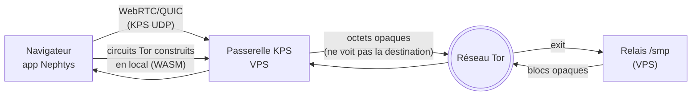

# Nephtys

**Nephtys** est une plateforme de communication chiffrée développée par **Jematechnology**. Elle propose une messagerie de bout en bout, des appels audio/vidéo WebRTC, des groupes, des statuts éphémères, et un **mode privé sans compte** avec **routage Tor « un clic » depuis le navigateur** (client Tor en WebAssembly — aucune extension, aucune installation).

> Application 100 % navigateur (PWA). Le **mode privé** ne demande aucun compte.

---

## Deux modes

| | **Mode compte** | **Mode privé (anonyme)** |
|---|---|---|
| Accès | Inscription / connexion (backend managé) | Sans compte, sans inscription |
| Interface | Application complète (barre latérale, chats, contacts, appels) | Interface **dédiée, plein écran**, isolée de l'app connectée |
| Transport | Backend temps réel | **Relais aveugle** (files opaques) |
| Identité | Compte serveur | **Identité locale** (clés sur l'appareil) |
| Tor | — | **Oui**, « Router via Tor » (client Tor WASM) |

---

## Fonctionnalités

- **Messagerie de bout en bout** : chiffrement **X25519** + **sealed sender** (anonymat de l'expéditeur). Les primitives **Double Ratchet** (forward secrecy) et **post‑quantique (ML‑KEM)** sont présentes dans le code mais **désactivées en production** (bugs `OperationError` en cours de correction).
- **Mode privé** : connexions 1‑à‑1 par **invitation** (lien/QR), sans compte ; le relais ne voit que des blocs opaques.
- **Groupes privés** : clé de groupe distribuée via les files du relais, rotation à l'ajout/retrait de membres.
- **Statuts éphémères** : chiffrés, expirés automatiquement.
- **Appels audio/vidéo** WebRTC (désactivés en mode Tor — voir limites).
- **Partage de fichiers** chiffré, avec aperçus (images, PDF, documents).
- **Multi‑appareils** : liaison d'appareil (transfert des clés E2EE via QR/lien).
- **Tor intégré** : bouton « Router via Tor » (paramètres → confidentialité).

---

## Tor « un clic » — comment ça marche

Un navigateur ne peut pas ouvrir de socket TCP ni parler à Tor directement. Nephtys contourne ça **sans rien installer** :



- Le **client Tor (Arti) tourne dans le navigateur**, compilé en **WebAssembly** (`tor-js`), wasm auto‑hébergé.
- La **passerelle KPS** (VPS) ne relaie que des **octets opaques** : elle **ne voit pas la destination** ni le contenu.
- Les blocs du mode privé transitent par le **pont relais‑over‑HTTP** (`/smp/up`, `/smp/down`).
- Résultat : le **relais ne voit qu'une sortie Tor**, jamais l'IP de l'utilisateur ; aucun logiciel externe (ni Tor Browser, ni Orbot).

---

## Architecture

- **Interface** : React 18 + TypeScript + Vite, Tailwind CSS + Radix UI, TanStack Query, react-router 7.
- **Mode compte** : backend managé (authentification, base de données, temps réel, stockage). E2EE et sealed sender appliqués **côté client**.
- **Mode privé** : protocole de **files aveugles** (transport navigateur vendoré sous AGPL‑3), relais **aveugle** (`server/smp-broker`).
- **Tor WASM** : `tor-js` (Arti/WASM) + passerelle KPS (`server/tor`) + pont `server/tor/smp-http-bridge.mjs`.
- **Crypto** : `@noble/curves|ciphers|hashes|post-quantum`.

### Serveur (`server/`)

| Composant | Rôle |
|---|---|
| `smp-broker/` | Relais aveugle profil navigateur (WebSocket) |
| `tor/gateway.mjs` | Passerelle WebSocket→Tor (secours) |
| `tor/smp-http-bridge.mjs` | Pont relais‑over‑HTTP (up/down) ↔ broker |
| `tor/setup.sh` | Installation Tor sur le VPS |
| `turn-creds/` | Délivrance des identifiants TURN (appels) |
| `relay.mjs` | Relais aveugle générique |

---

## Modèle de sécurité — et ses limites

**Garanti (actif en production)**
- E2EE de bout en bout (**X25519**) et **sealed sender**.
- Mode privé : pas de compte, relais aveugle, **invitations explicites** (pas d'annuaire).

**Présent mais désactivé (en cours de correction)**
- **Double Ratchet** (forward secrecy) et **post‑quantique (ML‑KEM)** : code présent, **non activés en production** (bugs `OperationError`).

**Limites (assumées)**
- **Pas d'audit indépendant** à ce jour.
- **Fingerprinting navigateur** non neutralisé (impossible depuis une page web).
- Mode Tor : le **premier saut (passerelle KPS) voit l'IP** — comme le *garde* d'un circuit Tor classique ; le relais, lui, ne voit qu'une sortie Tor.
- **Mode compte** : centralisé → le serveur voit des métadonnées.

### Comparatif (honnête)

| Critère | Nephtys privé | Nephtys compte | Signal | Telegram |
|---|---|---|---|---|
| E2EE par défaut | Oui (X25519) | Oui (X25519) | Oui | Non |
| Post‑quantique | Présent (off) | Présent (off) | Oui | Non |
| Sealed sender | Oui | Oui | Oui | Non |
| Compte / identifiant | Aucun | Compte | N° tél. | N° tél. |
| Métadonnées serveur | Minimales | Élevées | Faibles | Élevées |
| Tor intégré | **WASM, un clic** | Non | Proxy | Non |
| Audit indépendant | Non | Non | Oui | Non |
| Installation | **Aucune** | Aucune | App | App |

---

## Démarrage

### Prérequis
- Node.js ≥ 20, npm

### Installation
```bash
git clone https://github.com/JemaOS/Nephtys.git
cd Nephtys
npm install
```

### Variables d'environnement (`.env`)

Le mode compte utilise les identifiants de votre backend (URL + clé publique), fournis dans la configuration du déploiement. Mode privé et Tor :

```dotenv
VITE_SMP_RELAY_URL=wss://relais.exemple/
VITE_SMP_RELAY_KEY_HASH=
VITE_TOR_GATEWAY=1.2.3.4:12298:uEiA...
```

### Lancer
```bash
npm run dev      # http://localhost:5173
```

---

## Scripts

| Script | Description |
|---|---|
| `npm run dev` | Serveur de développement |
| `npm run build` | Build de production |
| `npm run preview` | Prévisualiser le build |
| `npm run typecheck` | Vérification TypeScript |
| `npm run lint` | ESLint |
| `npm run test:run` | Tests unitaires (Vitest) |
| `npm run test:e2e` | Tests bout‑en‑bout (Playwright) |
| `npm run relay` | Lancer le relais aveugle Node |

---

## Licence

**GNU Affero General Public License v3.0 (AGPL‑3.0)** — voir [LICENSE](LICENSE).

`tor-js` est distribué sous MIT/Apache‑2.0. Certains composants navigateur tiers sont sous **AGPL‑3** (voir le fichier de licence dédié à la racine du dépôt).

---

Copyright © 2025 Jematechnology. Tous droits réservés.
