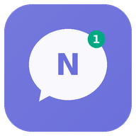
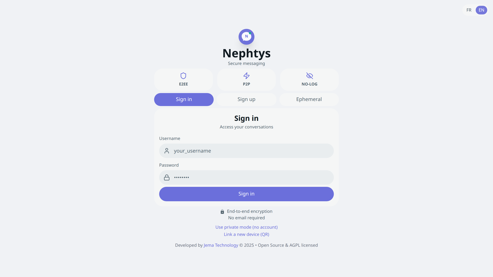
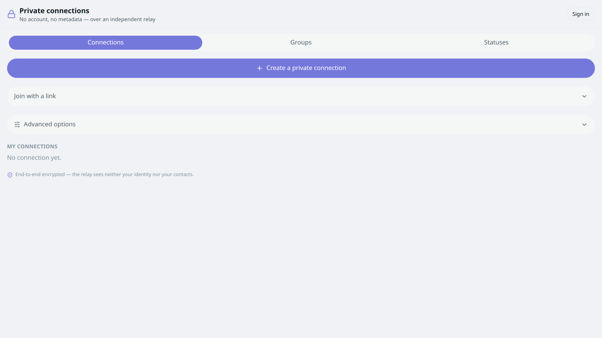

<div align="center">



# Nephtys

### Encrypted messaging, calls and a private, Tor-routed mode — no install

[](https://www.jematechnology.fr)
[](LICENSE)
[](https://react.dev)
[](https://www.typescriptlang.org)
[](https://webrtc.org)
[](https://www.torproject.org)
[](#-security-model--limits)
[](#-getting-started)
[](#-contributing)

**End-to-end encrypted messaging · WebRTC calls · groups · ephemeral statuses · private mode over a Tor client in WebAssembly**

[Features](#-features) · [Screenshots](#-screenshots) · [Two modes](#-two-modes) · [Security](#-security-model--limits) · [Getting started](#-getting-started) · [License](#-license)

</div>



---

## ✨ Features

- **End-to-end encrypted messaging**: **X25519 + Double Ratchet** (forward secrecy) + **post-quantum hybrid (ML-KEM-768)** + **sealed sender** (sender anonymity).
- **Authenticated keys**: public X25519 keys are **signed (Ed25519)** and verified before use; ratchet prekeys are signed (anti-interception / anti-downgrade).
- **Encrypted text, media and voice notes** — encryption is **fail-closed** (never falls back to plaintext).
- **Private mode**: 1-to-1 connections by **invitation** (link/QR), no account; the relay only sees opaque blocks.
- **Private groups**: group key distributed via the relay, **signed payloads**, rotation on member add/remove.
- **Ephemeral statuses**: encrypted, auto-expiring.
- **WebRTC audio/video calls** (disabled under Tor), with **explicit consent** on receive.
- **Encrypted file sharing** with previews (images, PDF, documents).
- **Multi-device**: device linking (E2EE key transfer via QR/link).
- **Built-in Tor**: one-click *“Route via Tor”* (settings → privacy).
- **Local-first retention**: history lives on the device; the server purges delivered/read messages after a grace window.

---

## 📸 Screenshots

<p align="center">
  
  <br />
  
</p>

---

## 🧭 Two modes

| | **Account mode** | **Private mode (anonymous)** |
| --- | --- | --- |
| Access | Sign up / sign in (managed backend) | No account, no sign-up |
| UI | Full app (sidebar, chats, contacts, calls) | Dedicated **full-screen** UI, isolated from the signed-in app |
| Transport | Realtime backend | **Blind relay** (opaque queues) |
| Identity | Server account | **Local identity** (keys on device) |
| Tor | — | **Yes**, *“Route via Tor”* (Tor WASM client) |

---

## 🔐 Security model — and limits

- Messages are **end-to-end encrypted**; the server never sees plaintext.
- The **relay is blind**: it forwards opaque blocks and learns neither content nor identity.
- **Limits**: WebRTC calls cannot run over Tor (browser constraint), and metadata protection depends on the mode you pick. See the source and docs for the honest comparison.

---

## 🚀 Getting started

### Prerequisites
- [Node.js](https://nodejs.org) 18+
- npm

### Install & run

```bash
git clone https://github.com/JemaOS/Nephtys.git
cd Nephtys
npm install
npm run dev
```

### Environment variables

Create a `.env` (see `.env.example`):

```bash
# Account mode (managed backend)
VITE_SUPABASE_URL=...
VITE_SUPABASE_ANON_KEY=...

# Anti-bot CAPTCHA (optional)
VITE_CAPTCHA_ENABLED=false
VITE_CAPTCHA_PROVIDER=turnstile
VITE_CAPTCHA_SITE_KEY=...
```

### Build

```bash
npm run build       # production build
npm run preview     # preview locally
```

### Tests

```bash
npm test            # unit tests (Vitest)
npm run test:e2e    # end-to-end tests (Playwright)
npm run lint        # ESLint
npm run relay       # run the relay server
```

---

## 🛠️ Tech stack

- **React 18** + **TypeScript** + **Vite**
- **Supabase** (account mode) · **@tanstack/react-query**
- **WebRTC** (`@kpstreams/*`) · **Tor** (`tor-js`, WASM)
- **Cryptography**: `@noble/ciphers`, `@noble/curves`, `@noble/hashes`, `@noble/post-quantum`, `@scure/bip39`, `tweetnacl`
- **TailwindCSS** + **Radix UI**
- **Vitest** + **Playwright**

---

## 🤝 Contributing

Contributions are welcome! Fork, branch, and open a pull request.

```bash
git checkout -b feat/my-feature
git commit -m "feat: my feature"
git push origin feat/my-feature
```

---

## 📄 License

Released under the **GNU AGPL-3.0** — see [LICENSE](LICENSE).

<div align="center">
Made with ❤️ by <a href="https://www.jematechnology.fr">Jema Technology</a>
</div>
